<p align="center">
  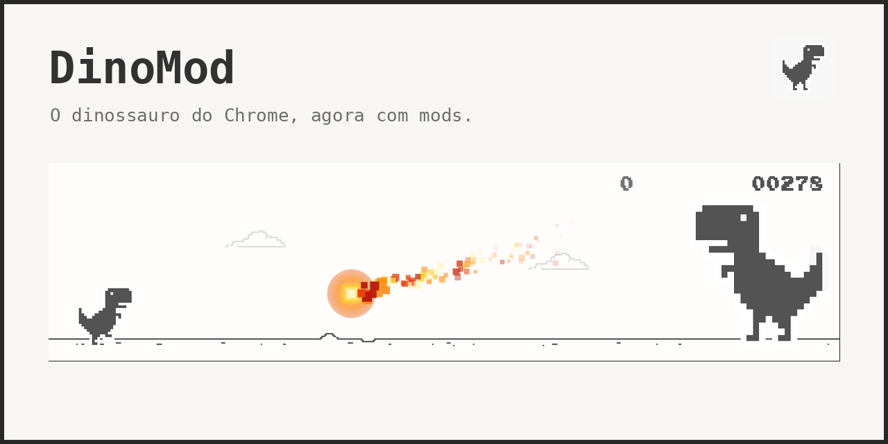
</p>

<h1 align="center">🦖 DinoMod</h1>

<p align="center">
  <b>O dinossauro do Chrome, agora com mods.</b><br>
  <i>An attempt to make Chrome Dino more accessible for heavy modifications. Anyone can use this project for modifications.</i>
</p>

<p align="center">
  <a href="https://xmyguel-x.github.io/"><b>▶ Jogar agora</b></a> ·
  <a href="#modos-prontos">Mods</a> ·
  <a href="#criar-o-seu-proprio-mod">Criar mod</a> ·
  <a href="#api-de-mods">API</a> ·
  <a href="#contribuindo">Contribuindo</a> ·
  <a href="CHANGELOG.md">Changelog</a>
</p>

<p align="center">
  
  
  
  
  
</p>

---

## 📖 Índice

- [O que é](#o-que-é)
- [Screenshots](#screenshots)
- [Modos prontos](#modos-prontos)
- [Combinações de mods](#combinações-de-mods)
- [🔥 Final: T-Rex Gigante](#-final-t-rex-gigante)
- [🎨 Favicon animado](#-favicon-animado)
- [⚔️ Modo Batalha](#-modo-batalha)
- [Criar o seu próprio mod](#criar-o-seu-próprio-mod)
- [API de mods](#api-de-mods)
- [Rodar localmente](#rodar-localmente)
- [Estrutura do projeto](#estrutura-do-projeto)
- [Contribuindo](#contribuindo)
- [Perguntas frequentes](#perguntas-frequentes)
- [Créditos e licença](#créditos-e-licença)

---

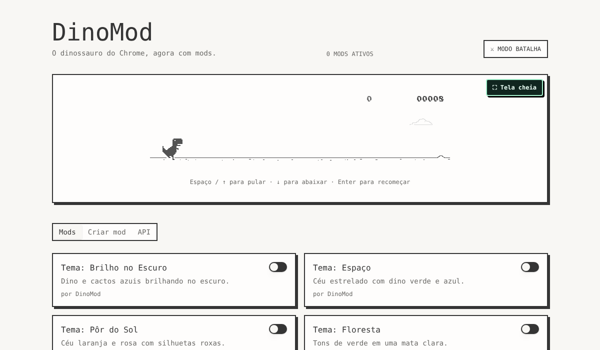

## O que é

O DinoMod pega o jogo do dinossauro do Chrome e o transforma numa plataforma de mods que roda direto no navegador, sem instalar nada.
Você liga e desliga mods com um clique, mistura vários ao mesmo tempo, **escreve o seu próprio mod em JavaScript** na própria página e ainda tem um modo de luta para dois jogadores.

- **16 mods prontos:** 8 temas, skins, física, HUD e um **final com chefe** (veja abaixo).
- **Criador de mods no navegador:** escreva, instale e teste na hora (aba *Criar mod*). Os mods ficam salvos no seu navegador e também dá para importar arquivos `.js` ou `.json`.
- **API pequena e simples:** eventos (`frame`, `jump`, `collision`...), ajustes de física e desenho direto no canvas.
- **Modo Batalha:** dois dinos, duas espadas, uma tela.
- **Tela cheia, tela retina/celular e favicon animado** que reproduz o estado do dino.
- **Site estático, zero dependências, zero build:** é HTML, CSS e JavaScript puro.

> É um projeto de fã, sem vínculo com o Google ou com a SEGA.

## Screenshots

| | |
|---|---|
| 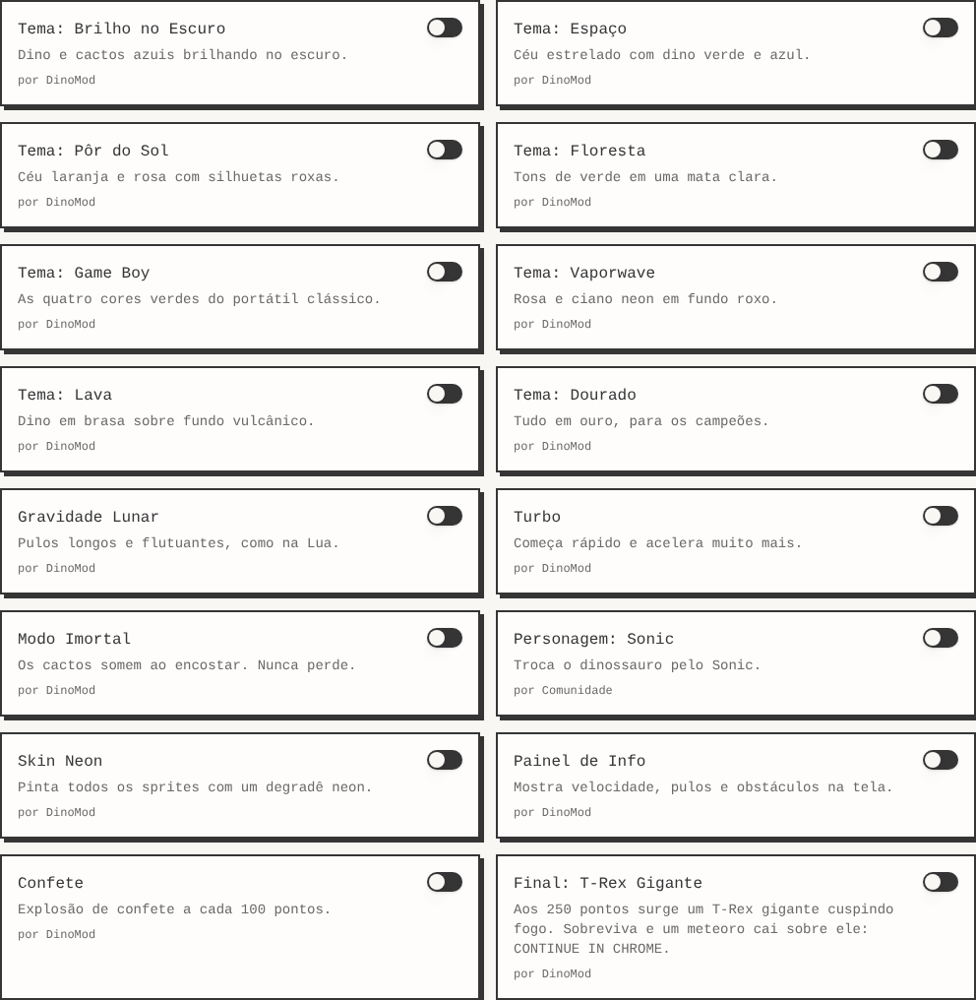 **Mods:** ligue e combine à vontade | 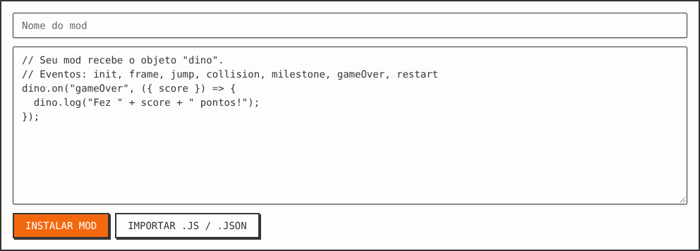 **Criar mod:** escreva o seu em JavaScript |
| 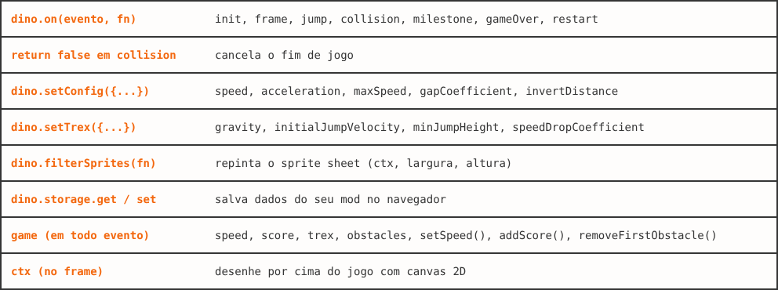 **API:** tudo que um mod pode usar | 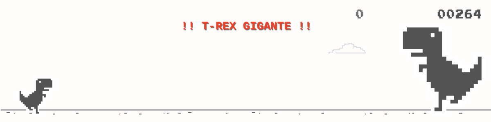 **Chefe final:** o T-Rex gigante aos 250 pontos |

### Combinações de mods

Os mods se somam. Estes são dois exemplos tirados do próprio site:

**Tema: Vaporwave + Personagem: Sonic + Painel de Info**
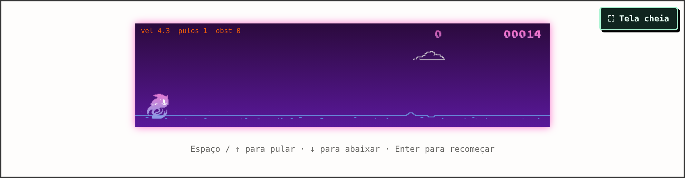

**Tema: Lava + Skin Neon + Turbo + Confete**
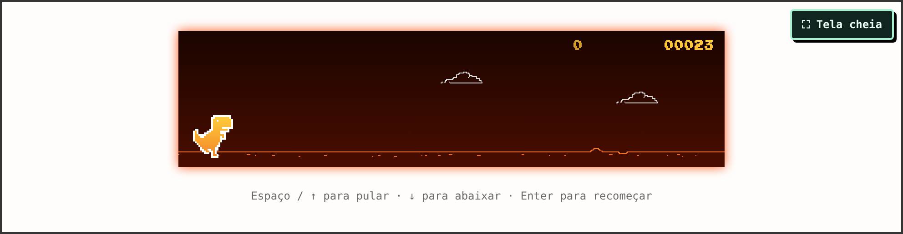

## Modos prontos

### Temas (8)

| Mod | O que faz |
|---|---|
| Tema: Brilho no Escuro | Dino e cactos azuis brilhando no escuro. |
| Tema: Espaço | Céu estrelado com dino verde e azul. |
| Tema: Pôr do Sol | Céu laranja e rosa com silhuetas roxas. |
| Tema: Floresta | Tons de verde em uma mata clara. |
| Tema: Game Boy | As quatro cores verdes do portátil clássico. |
| Tema: Vaporwave | Rosa e ciano neon em fundo roxo. |
| Tema: Lava | Dino em brasa sobre fundo vulcânico. |
| Tema: Dourado | Tudo em ouro, para os campeões. |

### Gameplay e visual (7)

| Mod | O que faz |
|---|---|
| Gravidade Lunar | Pulos longos e flutuantes, como na Lua. |
| Turbo | Começa rápido e acelera muito mais. |
| Modo Imortal | Os cactos somem ao encostar. Nunca perde. |
| Personagem: Sonic | Troca o dinossauro pelo Sonic. |
| Skin Neon | Pinta todos os sprites com um degradê neon. |
| Painel de Info | Mostra velocidade, pulos e obstáculos na tela. |
| Confete | Explosão de confete a cada 100 pontos. |

### Final (1)

| Mod | O que faz |
|---|---|
| 🔥 Final: T-Rex Gigante | Chefe de três fases aos **250 pontos**. Veja abaixo. |

## 🔥 Final: T-Rex Gigante

Um mod de final para o jogo. Ligue **"Final: T-Rex Gigante"** na aba *Mods* e chegue aos **250 pontos**:

1. Um T-Rex gigante surge pela direita.
2. Ele cospe bolas de fogo: **pule** as que vêm rente ao chão e **abaixe-se** (↓) nas que vêm na altura da cabeça. Algumas vêm em dupla.
3. Se você sobreviver, um **meteoro** cai sobre ele.
4. O T-Rex para, tomba, e aparece **CONTINUE IN CHROME**. `Enter` recomeça.

| 1. Surge | 2. Bafo de fogo | 3. Meteoro |
|---|---|---|
|  | 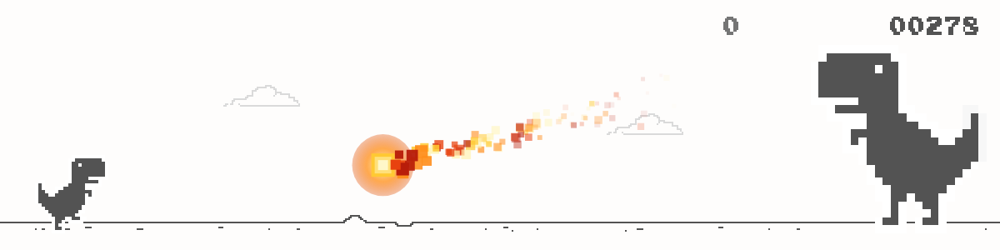 | 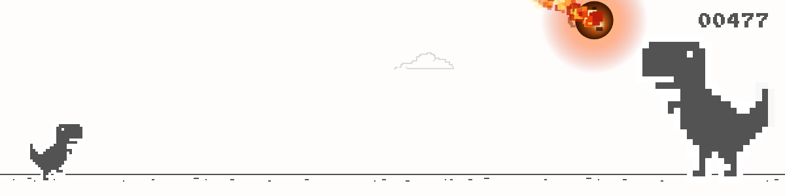 |

| 4. Impacto | 5. Tombo | 6. Final |
|---|---|---|
| 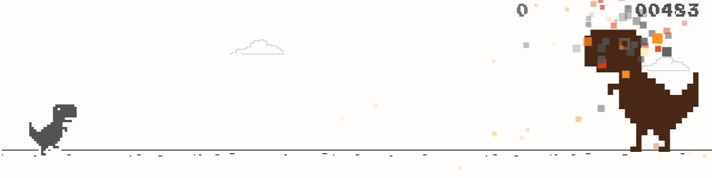 | 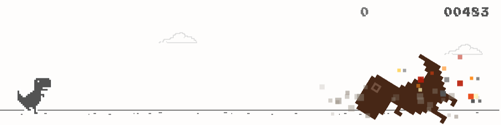 | 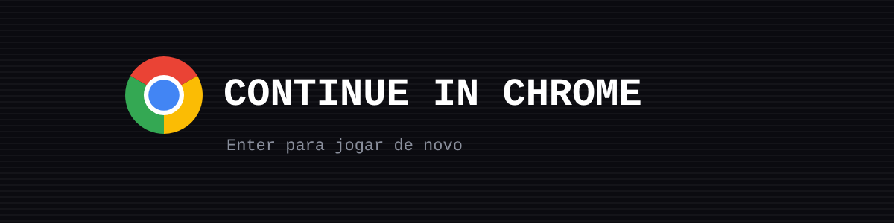 |

Os sons são sintetizados pelo próprio mod. O código-fonte comentado está em [`mods/final-trex-gigante.js`](mods/final-trex-gigante.js) e dá para ajustar a pontuação do chefe (`BOSS_SCORE`), o tamanho (`S`) e a sequência de ataques (`PLAN`) no topo do arquivo.

## 🎨 Favicon animado

O ícone da aba reproduz o estado do dino do jogo, desenhado direto do sprite original ([`favicon.js`](favicon.js)):

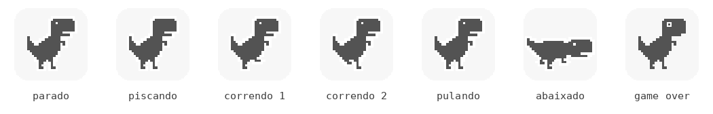

- **Parado:** de pé, **piscando** de vez em quando.
- **Jogando:** **correndo**, alternando as duas passadas do sprite.
- **Pulando / abaixado / game over:** muda o quadro de acordo (olho de X no fim).
- **Modo noite do jogo:** as cores do ícone invertem junto.

## ⚔️ Modo Batalha

Dois jogadores, uma tela, duas espadas.

- **Jogador 1 (azul):** `A` / `D` para andar, `W` para pular, `S` para golpear.
- **Jogador 2 (vermelho):** `←` / `→` para andar, `↑` para pular, `↓` para golpear.
- **Golpeiem ao mesmo tempo para as espadas se chocarem** — e saiam empurrados para trás.
- Cada round acaba quando alguém leva; o placar de rounds fica no topo (`P1` / `P2`) e a próxima luta começa sozinha.

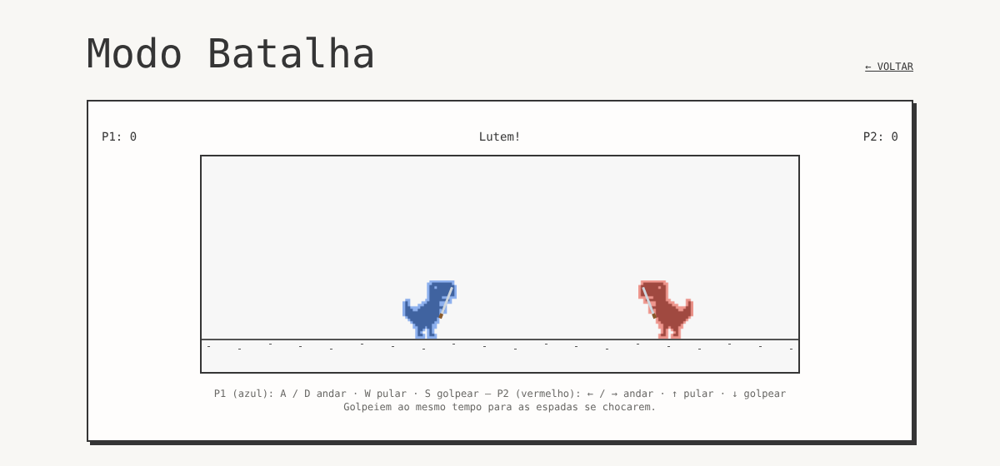

## Criar o seu próprio mod

Abra a aba **Criar mod**, cole o código, clique em *Instalar mod* e o mod entra no jogo na hora.
Ele fica salvo no seu navegador (`localStorage`), e você também pode importar arquivos `.js` ou `.json`.

**Pulos lunares** (um mod de uma linha)

```js
dino.setTrex({ gravity: 0.3, initialJumpVelocity: 9 });
```

**Modo imortal** (cancela o fim de jogo)

```js
dino.on("collision", ({ game }) => {
  game.removeFirstObstacle();
  return false; // cancela o fim de jogo
});
```

**Contador de pulos com bônus de pontos** (desenha no canvas)

```js
let jumps = 0;
dino.on("jump", ({ game }) => { jumps++; game.addScore(2); });
dino.on("restart", () => (jumps = 0));
dino.on("frame", ({ ctx }) => {
  ctx.fillStyle = "#e8590c";
  ctx.font = "10px monospace";
  ctx.fillText("pulos: " + jumps, 8, 14);
});
```

**Recorde que persiste** (usa `dino.storage`)

```js
let best = dino.storage.get("best", 0);
dino.on("gameOver", ({ score }) => {
  if (score > best) { best = score; dino.storage.set("best", best); }
  dino.log("melhor pontuação:", best);
});
```

## API de mods

Um mod é um trecho de JavaScript que recebe o objeto `dino`.

| API | O que faz |
|---|---|
| `dino.on(evento, fn)` | Eventos: `init`, `frame`, `jump`, `collision`, `milestone`, `gameOver`, `restart` |
| `return false` em `collision` | Cancela o fim de jogo |
| `dino.setConfig({...})` | `speed`, `acceleration`, `maxSpeed`, `gapCoefficient`, `invertDistance` |
| `dino.setTrex({...})` | `gravity`, `initialJumpVelocity`, `minJumpHeight`, `speedDropCoefficient` |
| `dino.filterSprites(fn)` | Repinta o sprite sheet `(ctx, largura, altura)` |
| `dino.setSpriteSheet({...})` | Troca o sprite sheet (a skin do Sonic usa isto) |
| `dino.storage.get / set` | Salva dados do seu mod no navegador |
| `dino.log(...)` | Escreve no console do navegador, com o nome do mod |
| `game` (em todo evento) | `speed`, `score`, `trex`, `obstacles`, `setSpeed()`, `addScore()`, `removeFirstObstacle()` |
| `ctx` (no `frame`) | Desenhe por cima do jogo com canvas 2D |

> Se o seu mod lançar um erro, o DinoMod desativa o trecho que falhou e mostra um aviso, sem derrubar o jogo.

## Rodar localmente

É um site estático. Sirva a pasta com qualquer servidor:

```bash
git clone https://github.com/xmyguel-x/xmyguel-x.github.io.git
cd xmyguel-x.github.io
python3 -m http.server 8000   # e abra http://localhost:8000
```

> Abrir o `index.html` direto pelo `file://` não funciona: o navegador bloqueia os módulos ES por política de origem. Use sempre um servidor.

### Conferir se o site está inteiro

O repositório traz um verificador que checa se todos os arquivos referenciados existem, se os screenshots do README estão presentes e se as coordenadas do sprite sheet batem com o tamanho real da imagem:

```bash
python3 scripts/verify_site.py
```

O mesmo verificador roda em cada push, na aba **Actions** do repositório.

## Estrutura do projeto

```
index.html            página (instantâneo do app + scripts de inicialização)
404.html              fallback de rotas do GitHub Pages (links diretos como /batalha)
favicon.js            favicon animado que acompanha o dino
favicon.svg           ícone estático do site
favicon.ico           mesmo ícone, no caminho que o navegador pede sozinho
apple-touch-icon.svg  ícone para a tela inicial do iOS
fullscreen.js         botão de tela cheia
assets/
  engine-*.js         motor do jogo (Chrome Dino adaptado) + API de mods
  routes-*.js         página inicial, lista de mods e criador de mods
  batalha-*.js        Modo Batalha
  index-*.js          app (React + TanStack Router)
dino/                 sprites (1x, 2x) e sons do jogo
mods/                 código-fonte legível dos mods maiores
docs/screenshots/     imagens deste README
scripts/              ferramentas do repositório (verificador e conversores)
dino-slide/           jogo independente em 16:9, para apresentação
powerpoint/           pacote do Chrome Dino dentro do PowerPoint (VBA)
```

### Por que alguns PNGs são `.svg`

Os assets binários novos (a folha de sprites 2x, o ícone do site e os screenshots)
estão no repositório como **SVG que carrega o PNG original embutido em base64**:

```svg
<image href="data:image/png;base64,iVBORw0KGgo…" width="2466" height="200"/>
```

O motivo é prático: o fluxo automatizado de publicação do repositório só consegue
gravar **texto UTF-8**, e um PNG binário não sobrevive a essa viagem. Como SVG é
texto, o arquivo entra no repositório normalmente — e o navegador desenha os
**mesmos pixels** que o PNG, inclusive no recorte por retângulo de fonte que o
motor usa na folha de sprites.

Para voltar ao PNG original:

```bash
python3 scripts/svg_wrapper.py --extract dino/sprite-2x-v2.svg sprite-2x-v2.png
```

E para gerar o `.svg` a partir de um PNG novo:

```bash
python3 scripts/svg_wrapper.py meu-assets.png meu-assets.svg
```

O `scripts/verify_site.py` confere que o PNG embutido tem as dimensões certas.

## Contribuindo

Mods, correções e melhorias são bem-vindos. O guia completo está em **[CONTRIBUTING.md](CONTRIBUTING.md)**, mas o resumo é:

1. **Crie uma branch** a partir de `main`.
2. **Escreva o seu mod** em JavaScript — um arquivo só, começando por `dino.on(...)`.
3. **Rode `python3 scripts/verify_site.py`** antes de abrir o PR.
4. **Abra um Pull Request** descrevendo o que o mod faz.

Se você só quer usar um mod, não precisa de nada disso: cole o código na aba *Criar mod* e ele já funciona.

## Perguntas frequentes

**O jogo não abre / a página fica branca.**
O site precisa ser servido por HTTP, não por `file://`. Veja [Rodar localmente](#rodar-localmente).

**Aparece "Invalid hook call" no console.**
O mesmo módulo JavaScript foi carregado com URLs diferentes, criando duas cópias do React. Todas as URLs de módulo do `index.html` precisam ser únicas.

**O dinossauro aparece achatado ou cortado em tela retina / celular.**
A folha de sprites 2x (`dino/sprite-2x-v2.svg`) precisa ter o mesmo layout da 1x, com as mesmas proporções. O verificador do repositório checa isso.

**Os PNGs do repositório são `.svg`.**
É de propósito: o SVG carrega o PNG original embutido em base64, para que o fluxo automatizado de publicação consiga gravar o arquivo (que é texto). Os pixels são idênticos. Veja [Por que alguns PNGs são `.svg`](#por-que-alguns-pngs-são-svg).

**Por que existe um `favicon.ico` que é um SVG?**
O roteador injeta `<link rel="icon" href="/favicon.ico">` em tempo de execução, e o navegador pede esse caminho antes de qualquer script rodar. Como não dá para gravar um ICO binário pelo mesmo fluxo que gravou o resto, o arquivo serve o mesmo SVG do `favicon.svg` — o pedido volta com 200 em vez de 404, e o `favicon.js` desenha o dino animado por cima dele.

**Meu mod parou de funcionar.**
Abra o console (`F12`): o DinoMod registra o erro e desativa só o trecho que falhou. O resto do jogo continua.

**Onde os meus mods ficam salvos?**
No `localStorage` do seu navegador, em `localStorage`. Limpar os dados do site apaga os mods criados.

## Créditos e licença

Projeto de fã. O jogo e os sprites do dinossauro vêm do **Chrome Dino** do projeto Chromium (licença BSD-3-Clause).
Sonic é marca da SEGA; a skin é uma homenagem feita por fã.

- **Código do DinoMod e dos mods:** MIT — veja [LICENSE](LICENSE).
- **Sprites e sons do Chrome Dino:** BSD-3-Clause, © The Chromium Authors.
- **Sprite do Sonic:** © SEGA, usado como homenagem.

O **Dino Runner 16:9** (`dino-slide/`) e o **Chrome Dino no PowerPoint** (`powerpoint/`) são projetos paralelos do mesmo repositório.
